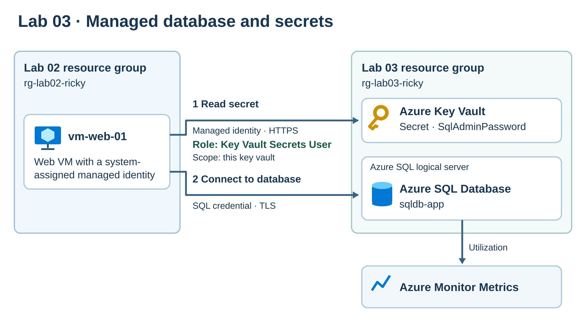

# Lab 03 · Modernize the database tier and secure its credentials

Lab 02 used two Azure virtual machines, one for the web tier and one for the database tier. This lab keeps the web VM and replaces the database VM with Azure SQL Database. Azure manages database infrastructure, patching, and automated backups. The web VM uses its system-assigned managed identity to read a SQL credential from Azure Key Vault.

**Use case.** A small application team wants to retire a database server while keeping its existing web host. Storing the SQL password in Key Vault lets the application retrieve it at runtime without putting it in source control.

## Architecture



The arrows show the intended application flow. The VM authenticates to **Key Vault** with its managed identity. The SQL connection shown uses **SQL authentication** with the retrieved password. A client configured for Microsoft Entra managed-identity authentication to SQL uses a separate flow and requires its own database permissions.

## Reproduce the lab

Start with an Azure subscription, a running `vm-web-01` from [Lab 02](https://github.com/RickyGonzalez/lab02Secure2TierApp), and permission to create resources and assign roles. The resource names below are examples. Choose available, globally unique names for the SQL logical server and vault.

1. **Retire the disposable database VM.** In `rg-lab02-ricky`, identify `vm-db-01` and its attached OS disk and NIC. Remove the database VM and those dedicated resources. Confirm that `vm-web-01` is still running. This lab provisions an empty database. For a database containing real data, migrate it and validate the new application connection before retiring the source.
2. **Provision the managed database.** In **SQL databases → Create**, create `rg-lab03-ricky`, database `sqldb-app`, and a logical server such as `sql-server-ricky`. Select SQL authentication and create the lab administrator login `sqladmin`. Use the Basic DTU tier and locally redundant backups. Check the estimated cost before deploying.
3. **Configure SQL connectivity.** The exercise uses the public endpoint, adds the operator’s current public IP to the server firewall, and enables **Allow Azure services and resources to access this server**. That exception is broad and can include resources in other Azure subscriptions. SQL credentials are still required. The web VM also needs working outbound connectivity to the service.
4. **Create the vault and secret.** In the Lab 03 group, create a Standard vault such as `kv-lab03-ricky` using the Azure RBAC permission model. The exercise uses a public endpoint. Give the operator a vault-scoped data role that can create secrets (the exercise uses **Key Vault Administrator**). Under **Objects → Secrets → Generate/Import**, save the SQL administrator password as `SqlAdminPassword`.
5. **Authorize the web VM.** Open **vm-web-01 → Identity → System assigned**, enable the identity, and save. On the vault, open **Access control (IAM) → Add role assignment**. Assign **Key Vault Secrets User** to the managed identity of `vm-web-01` at vault scope. This allows the VM to read secrets in this vault. It does not grant a SQL database role.
6. **Inspect database utilization.** Open **sqldb-app → Monitoring → Metrics**. Select **DTU percentage** with **Max** aggregation for the Basic tier. If you used General Purpose serverless instead, select **CPU percentage**. A quiet database can show near-zero utilization.

## Validate each part independently

| Check | What to look for |
| --- | --- |
| Resource inventory | The database reports **Online**. The old database VM, its dedicated disk, and its NIC are gone. The web VM remains in the Lab 02 group. |
| Identity and permissions | The web VM has a principal ID. The vault lists that identity as **Key Vault Secrets User**. |
| Secret retrieval | From the web VM, the command below returns a versioned secret ID. This checks permission to read the secret without displaying its value. |
| SQL authentication | To test the password-based path, use a SQL client on the VM with SQL authentication, the logical server hostname, the target database, and the retrieved credential. Run `SELECT DB_NAME();` and check the returned database name. |
| Monitoring | The selected utilization metric has data points. This verifies telemetry. The SQL query independently verifies the client connection. |

Run this optional check inside the web VM with Azure CLI installed. Replace the vault name if you chose a different one.

```bash
az login --identity --allow-no-subscriptions --output none
az keyvault secret show --vault-name kv-lab03-ricky --name SqlAdminPassword --query id --output tsv
```

## Troubleshooting

- **Vault access denied.** Check which identity made the request. The operator and the web VM have separate role assignments. Confirm the vault scope, allow time for RBAC propagation, and verify the vault’s network settings permit the client.
- **SQL login fails.** Check the server hostname, database name, and client authentication mode. A token-based login tests Microsoft Entra authentication. To validate the flow in the diagram, choose SQL authentication and verify that the stored secret matches the SQL login.
- **SQL connection times out.** Check the web VM’s outbound path and the logical server’s firewall settings before changing credentials.

## Cleanup

When the resources are no longer needed, review the contents of `rg-lab03-ricky` before deleting that resource group. Deletion removes the logical server, database, and vault. Keep the Lab 02 group if a later exercise reuses the web VM.
